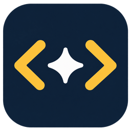
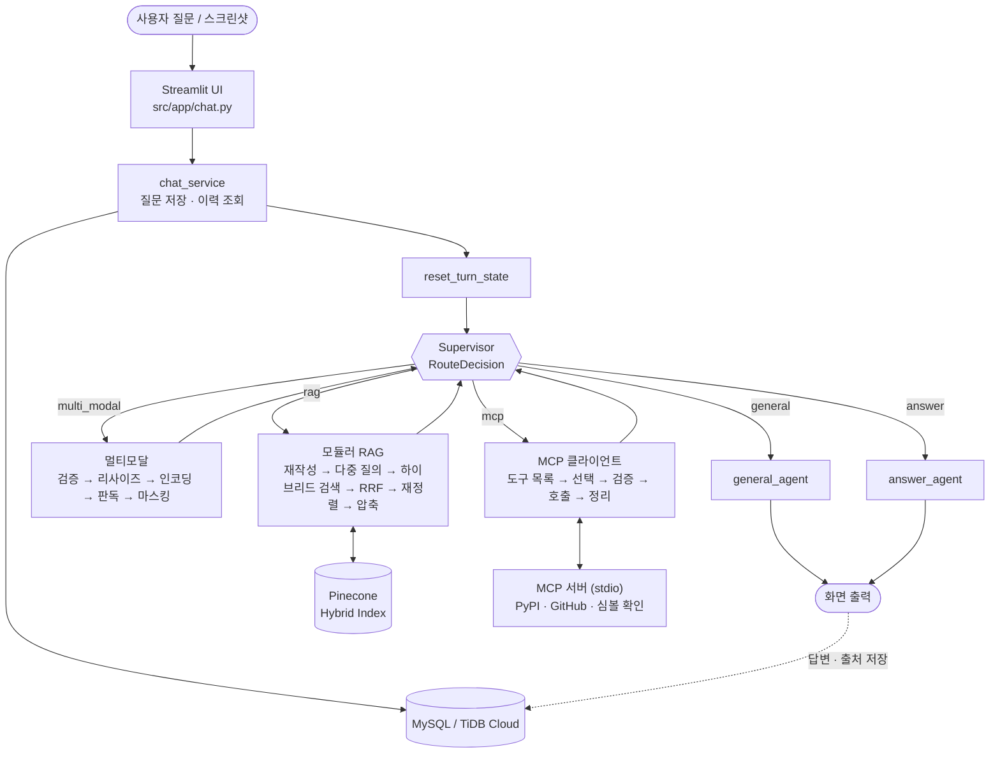
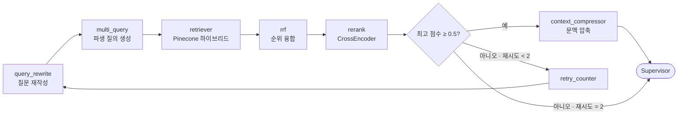
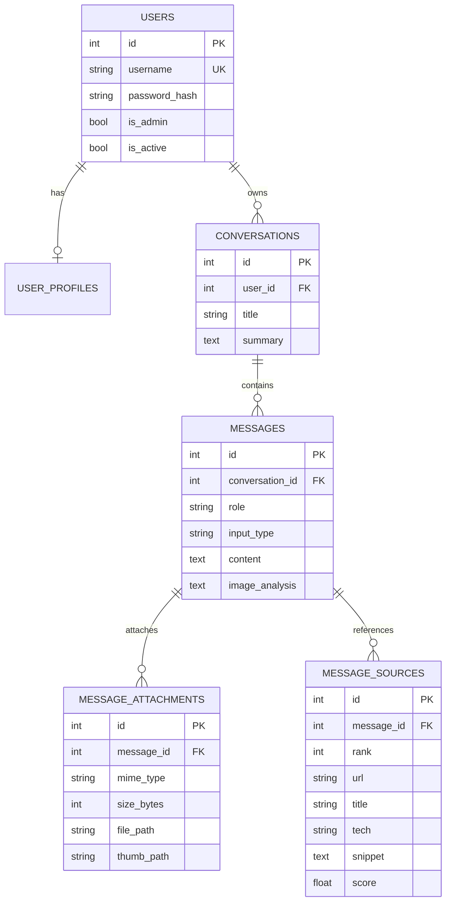

<div align="center">



# 🔍 CodeClue

**LangChain · LangGraph · MCP 개발 오류 분석 및 해결 도우미**

오류 메시지나 스크린샷을 올리면, 공식 문서 검색(RAG)과 실시간 도구 조회(MCP)를 근거로 원인과 해결 방법을 알려 주는 개발자용 챗봇

SKN35 3차 프로젝트 · 2팀


</div>

---

## 목차

1. [팀 소개](#1-팀-소개)
2. [프로젝트 기간](#2-프로젝트-기간)
3. [프로젝트 개요](#3-프로젝트-개요)
4. [기술 스택](#4-기술-스택)
5. [시스템 아키텍처](#5-시스템-아키텍처)
6. [수집 데이터 및 전처리](#6-수집-데이터-및-전처리)
7. [RAG · LangGraph 파이프라인](#7-rag--langgraph-파이프라인)
8. [MCP 서버와 멀티모달](#8-mcp-서버와-멀티모달)
9. [데이터베이스 설계](#9-데이터베이스-설계)
10. [디렉토리 구조](#10-디렉토리-구조)
11. [실행 방법](#11-실행-방법)
12. [테스트 계획 및 결과](#12-테스트-계획-및-결과)
13. [트러블 슈팅](#13-트러블-슈팅)
14. [한계 및 향후 개선](#14-한계-및-향후-개선)
15. [협업 방식](#15-협업-방식)

---

## 1. 팀 소개

<!-- GitHub 아이디는 커밋 기록으로 추정했습니다. 다르면 고쳐 주세요. -->

<table>
  <tr>
    <td align="center" width="25%"><br/><b>나치훈</b><br/><sub>A · 데이터 · 벡터 DB</sub></td>
    <td align="center" width="25%"><br/><b>박찬룡</b><br/><sub>B · LangGraph 파이프라인</sub></td>
    <td align="center" width="25%"><br/><b>고은하</b><br/><sub>C · 평가 · 테스트 · UI</sub></td>
    <td align="center" width="25%"><br/><b>박종원</b><br/><sub>D · MCP · 멀티모달</sub></td>
  </tr>
  <tr>
    <td align="center"><a href="https://github.com/Nachihun"></a></td>
    <td align="center"><a href="https://github.com/chan3623"></a></td>
    <td align="center"><a href="https://github.com/galaxyko2026-maker"></a></td>
    <td align="center"><a href="https://github.com/Eurypylos0924"></a></td>
  </tr>
</table>

| 식별자 | 이름 | 담당 내용 | 주요 코드 |
| :---: | :---: | --- | --- |
| **A** | 나치훈 | 문서와 이슈 수집, 전처리, 메타데이터, 벡터 DB | `crawler/`, `src/preprocessing/`, `src/rag/loader·splitter·retriever`, `src/vectorstore/`, `data/processed/` |
| **B** | 박찬룡 | LangGraph 파이프라인 (분기, 되묻기, 재검색, 출처 점검) | `src/graph/`, `src/agent/`, `src/rag/` 후처리, `src/prompt/` |
| **C** | 고은하 | 평가 질문 세트와 환각 점검, 테스트 보고서, UI | `src/evaluation/`, `src/app/`, `main.py` |
| **D** | 박종원 | MCP 서버, 이미지 입력 변환 (멀티모달) | `src/mcp_integration/`, `src/graph/node/mcp/`, `src/multi_modal/`, `src/db/` |

---

## 2. 프로젝트 기간

**2026.10.07 ~ 2026.10.15**

| 날짜 | 내용 |
| --- | --- |
| 10.07 | 주제 확정, 역할 분담, 프로젝트 구조 생성 |
| 10.08 ~ 10.09 | 공식 문서 수집·전처리, 모델·벡터 DB를 OpenAI + Pinecone으로 통일 |
| 10.10 ~ 10.12 | Supervisor 그래프, RAG 서브그래프, MCP 서버, DB 계층 구현, RAG 답변·출처 화면 연결 |
| 10.13 ~ 10.14 | 멀티모달·MCP·로그인 통합, 시나리오 테스트(T01~T12)와 재시험 |
| 10.15 | 검색·답변·출처 기준선(baseline) 평가, 최종 점검, 발표 |

---

## 3. 프로젝트 개요

### 3.1 프로젝트 소개

> LangChain · LangGraph · MCP로 개발하다 막힌 오류를 **글이나 스크린샷으로 올리면**,
> 수집한 **공식 문서**와 **실시간 도구 조회(PyPI · GitHub · 함수 존재 확인)** 를 근거로 원인과 해결 방법을 알려 주는 개발자용 질의응답 웹 서비스입니다.

### 3.2 문제 정의

- LLM 개발 프레임워크는 버전이 빠르게 바뀌어, 범용 LLM이 **이미 사라졌거나 존재하지 않는 함수**를 그럴듯하게 안내하는 일이 잦습니다.
- 오류 해결에 필요한 근거는 공식 문서, GitHub 이슈, 설치된 패키지 버전에 흩어져 있어 직접 찾기 번거롭습니다.
- 오류는 터미널 스크린샷으로 공유되는 경우가 많은데, 텍스트로 옮겨 적어야 검색할 수 있습니다.

### 3.3 핵심 기능

| 기능 | 설명 |
| --- | --- |
| 💬 일반 질문 | 인사·간단한 질문은 검색 없이 바로 답변 |
| 📚 공식 문서 검색 (RAG) | LangChain · LangGraph · MCP 공식 문서 146개(청크 3,918개)에서 하이브리드 검색 + 재정렬 |
| 🛠️ 외부 도구 조회 (MCP) | PyPI 최신 버전, 버전 호환성, GitHub 이슈 검색·조회, 함수/클래스 존재 확인 (도구 5개) |
| 🖼️ 스크린샷 질문 (멀티모달) | 이미지 최대 3장, 읽은 오류 문구를 화면에 보여 주고 검색에 활용 |
| 🔗 출처 표시 | 답변에 참고한 공식 문서 제목과 링크 표시 |
| 🔐 로그인 · 대화 저장 | 질문·답변·이미지·출처를 저장해 이전 대화를 이어서 질문 |
| ⏱️ 단계 표시 | 답변 생성 중 SUPERVISOR · RAG · MCP · MULTI_MODAL 진행 단계 표시 |

### 3.4 차별점

1. 답변마다 **참고 자료(출처 링크)** 를 함께 보여 줍니다.
2. 없는 함수를 있는 것처럼 설명하는 환각을 **MCP 함수 존재 확인 도구**로 교차 검증합니다.
3. 오류 **스크린샷만 올려도** 내용을 읽어 문서 검색에 씁니다.
4. 로그인하면 대화·이미지·출처가 저장되어 이어서 질문할 수 있습니다.

---

## 4. 기술 스택

| 구분 | 기술 |
| --- | --- |
| 언어 · 패키지 |    |
| 화면 |  |
| 에이전트 · RAG |   |
| LLM · 임베딩 |  -412991) |
| 재정렬 |  (sentence-transformers CrossEncoder) |
| 벡터 DB · 검색 |  Dense 70% + BM25 Sparse 30% 하이브리드 |
| 도구 연동 |  PyPI API, GitHub REST API |
| 관계형 DB |     |
| 협업 |   |

---

## 5. 시스템 아키텍처

중앙의 **Supervisor**가 질문과 지금까지 모은 정보를 보고 다음 작업을 고르는 허브 앤 스포크 구조입니다. RAG · MCP · 멀티모달은 결과를 Supervisor에 돌려주고, 정보가 충분해지면 `answer`로 최종 답변을 만듭니다.



| 계층 | 주요 파일 | 역할 |
| --- | --- | --- |
| UI | `src/app/chat.py`, `src/app/chat_service.py` | 채팅·로그인 화면, 그래프 앞뒤로 DB 저장 |
| 오케스트레이션 | `src/graph/workflow.py`, `state.py`, `node/supervisor_node.py` | 상태 관리, 경로 선택 |
| 서브 에이전트 | `src/agent/rag_agent.py`, `mcp_agent.py`, `multi_modal_agent.py`, `answer_agent.py` | 문서 검색, 도구 호출, 이미지 판독, 답변 생성 |
| 데이터 | `src/db/`, `src/vectorstore/` | 계정·대화·출처 저장, 공식 문서 벡터 인덱스 |

자세한 내용은 [시스템 아키텍쳐.md](./시스템%20아키텍쳐.md), [프로세스 흐름도.md](./프로세스%20흐름도.md)를 참고하세요.

---

## 6. 수집 데이터 및 전처리

> 상세 문서: [산출물/Codeclue 데이터_수집_및_전처리.md](./산출물/Codeclue%20데이터_수집_및_전처리.md)

### 6.1 데이터 출처

웹페이지를 크롤링하지 않고, 문서 사이트가 빌드되는 **GitHub 원본 저장소의 `.mdx`** 를 GitHub Tree API로 받습니다. HTML 변환이 없어 코드 블록과 문서 구조가 그대로 남습니다.

| 데이터 | 출처 (GitHub 원본) | 출처 링크 |
| --- | --- | --- |
| LangChain | `langchain-ai/docs` → `src/oss/langchain/` | docs.langchain.com/oss/python/langchain/ |
| LangGraph | `langchain-ai/docs` → `src/oss/langgraph/` | docs.langchain.com/oss/python/langgraph/ |
| MCP | `modelcontextprotocol/modelcontextprotocol` → `docs/docs/2026-07-28/`, `docs/specification/2026-07-28/` (최신 버전만) | modelcontextprotocol.io |
| 코드 예제 | `langchain-ai/docs` → `src/snippets/` (Python 예제 148개, 본문에 삽입) | — |

### 6.2 데이터 수량

| 구분 | Document | 본문 글자 수 | 코드 블록 수 | 청크 수 | 비율 |
| --- | ---: | ---: | ---: | ---: | :---: |
| LangChain | 55 | 947,518 | 1,067 | 1,307 | 33.4% |
| LangGraph | 38 | 698,872 | 706 | 993 | 25.3% |
| MCP | 53 | 1,152,585 | 493 | 1,618 | 41.3% |
| **합계** | **146** | **2,798,975** | **2,266** | **3,918** | 100% |

- 원본 `.mdx`는 148개이며, 정리 후 본문이 30자 미만인 LangChain `academy.mdx`, `retrieval.mdx` 2개를 빼서 Document는 146개입니다.
- 청크 3,918개는 BM25 학습 결과(`data/processed/bm25_params.json`)의 `n_docs = 3918`과 같습니다.
- 문서 유형: documentation 100 · specification 30 · error 13 · tutorial 3.

### 6.3 전처리 파이프라인

```text
collect_docs.py           GitHub 공식 문서 .mdx → data/raw/<tech>
collect_snippets.py       문서가 import 하는 Python 코드 예제 수집 (JS/TS 제외)
mdx_to_document.py        frontmatter 분리 → snippet 삽입 → JS/TS 블록 제거
                          → 코드 블록 밖의 JSX·import·HTML 정리 → documents.jsonl
loader.py / splitter.py   Markdown 구조 기반 청킹 (제목 경계 우선, 코드 블록 보존)
vectorstore/build.py      BM25 학습 → Pinecone에 Dense + Sparse 벡터 업로드
```

### 6.4 청킹 전략

| 설정 | 값 |
| --- | --- |
| 청크 크기 | 최대 1,000자 (긴 일반 문단만 overlap 150자) |
| 경계 | `#` 제목, ```` ``` ```` 코드 블록, 문단 경계를 지키며 분할 |
| 후처리 | 50자 미만 청크 제거, 같은 기술 안 중복 청크 sha256으로 제거, 청크 앞에 문서 제목 부착 |

고정 길이 분할(`RecursiveCharacterTextSplitter` 1000/150)과 비교했을 때 **코드 블록이 중간에서 잘린 청크가 958개(26.9%) → 0개**가 되었습니다. 청크 3,918개 중 1,926개(49.2%)가 코드 블록을 포함합니다.

### 6.5 메타데이터

| 키 | 예시 | 용도 |
| --- | --- | --- |
| `technology` | `langgraph` | 기술별 필터 |
| `document_type` | `error` / `specification` / `tutorial` / `documentation` | 문서 유형 필터 |
| `title` | `GRAPH_RECURSION_LIMIT` | 답변 출처 제목 |
| `source_url` | `https://docs.langchain.com/oss/python/langgraph/errors/...` | 답변 출처 링크 |
| `github_url` | `https://github.com/langchain-ai/docs/blob/main/...` | 원문 확인 |
| `parent_id`, `chunk_id` | `langgraph-errors-graph_recursion_limit-002` | 문서 ID, Pinecone 벡터 ID |

### 6.6 임베딩 · 적재

| 항목 | 내용 |
| --- | --- |
| Dense | OpenAI `text-embedding-3-small` (1536차원) |
| Sparse | BM25 (`pinecone_text` BM25Encoder, 우리 청크로 학습, avgdl 79.08, k1 1.2, b 0.75) |
| 인덱스 | Pinecone Serverless (aws `us-east-1`, `dotproduct`, 기본 이름 `skn35-rag`) |
| 검색 기본값 | `alpha = 0.7` (0.7 × Dense + 0.3 × Sparse), `top_k = 5`, 재정렬 후보 `FETCH_K = 20` |

---

## 7. RAG · LangGraph 파이프라인

### 7.1 Supervisor 분기

Supervisor는 구조화 출력(`RouteDecision`)으로 `general` · `rag` · `mcp` · `multi_modal` · `answer` 중 하나를 고릅니다. 이미지가 있으면 먼저 멀티모달로 읽고, 필요한 정보(문서·도구 결과)를 모은 뒤 `answer`로 넘어갑니다. 이미 끝낸 경로는 `completed_routes`에 기록해 같은 작업을 반복하지 않습니다. 정보가 부족한 질문에 되묻는 동작은 시나리오 T06에서 아직 실패해 개선 과제로 남아 있습니다.

### 7.2 모듈러 RAG 서브그래프



| 단계 | 하는 일 |
| --- | --- |
| 질문 재작성 | 한국어 질문을 영어 검색어·오류 키워드로 바꿔 BM25와 영어 문서에 맞춤 |
| 다중 질의 | 여러 관점의 검색어를 만들어 병렬 검색 (재현율 확보) |
| RRF | 여러 검색 결과를 `chunk_id` 기준으로 합쳐 순위 융합 |
| 재정렬 | 다국어 CrossEncoder `BAAI/bge-reranker-v2-m3`로 질문-청크 관련도 채점 |
| 재검색 | 최고 점수가 0.5 미만이면 최대 2회 질문을 다시 써서 재검색 (`src/const/rag_config.py`) |
| 압축 | 통과한 청크에서 질문과 관련된 부분만 남겨 답변 프롬프트에 전달 |

### 7.3 출처 점검

최종 `retrieved_docs`의 `source_url`(없으면 `github_url`)을 출처로 변환해 화면에 보여 주고 DB `message_sources`에 저장합니다. 로컬 경로로는 링크를 만들지 않고, 같은 URL은 한 번만 표시합니다.

---

## 8. MCP 서버와 멀티모달

### 8.1 MCP 서버 (`src/mcp_integration/server`)

앱과 분리된 **stdio MCP 서버**가 도구 5개를 제공합니다.

| 도구 | 기능 |
| --- | --- |
| `get_latest_version` | PyPI에서 패키지 최신 안정 버전 조회 |
| `check_version_compat` | 여러 패키지 버전 조합의 호환성 확인 |
| `search_github_issues` | LangChain · LangGraph · MCP 저장소 이슈/PR 검색 |
| `get_github_issue` | 이슈 본문과 댓글 조회 |
| `check_symbol_exists` | 설치된 라이브러리에 함수·클래스·모듈이 실제로 있는지 확인 (환각 방지) |

MCP 서브그래프는 `list_tools → select_tool → validate_call → call_tool → format_results` 순서로 동작하며, 도구 이름 오타·인자 오류·호출 실패가 나면 오류 메시지를 LLM에 돌려주어 최대 2회 다시 고르게 합니다. 도구 결과는 데이터로만 다루고, 결과 안의 지시문은 따르지 않도록 답변 규칙을 두었습니다.

### 8.2 멀티모달 (`src/multi_modal`)

```text
validate_images  →  resize_images  →  encode_images  →  read_images  →  build_analysis
장수·용량·형식 검사    비율 유지 축소       Base64 인코딩      Vision LLM 판독    비밀값 마스킹·정리
```

- 한 메시지에 이미지 최대 3장, 한 장 최대 약 2MB (`IMAGE_MAX_PER_MESSAGE`, `IMAGE_MAX_BYTES`)
- PNG · JPEG · WEBP는 파일 바이트로 형식을 판별
- Supervisor에는 원본 이미지가 아니라 장수 요약만, 다음 단계에는 판독 텍스트(`image_analysis`)만 넘깁니다.

---

## 9. 데이터베이스 설계



- 개발은 로컬 MySQL 8.4, 공유·시연은 TiDB Cloud를 쓰며 Alembic 마이그레이션 `0001`~`0005`로 구조를 관리합니다.
- 저장 직전 API 키(`sk-...`, `nvapi-...`) 등 비밀값을 `[MASKED:...]`로 바꿉니다 (`src/db/masking.py`).
- 대화 이력은 최근 6턴 · 1,500토큰 상한 안에서만 다음 질문에 붙입니다 (`HISTORY_MAX_TURNS`, `HISTORY_MAX_TOKENS`).
- 모든 조회는 `user_id`로 소유자를 확인합니다.

---

## 10. 디렉토리 구조

```text
SKN35-3rd-2Team
├── main.py                      # Streamlit 실행 진입점
├── pyproject.toml / uv.lock     # 의존성
├── .env.example                 # 환경변수 이름과 설명
├── crawler/collect_docs.py      # 공식 문서 .mdx 수집
├── data/processed/              # documents.jsonl, chunks.jsonl, bm25_params.json
├── src
│   ├── app/                     # 채팅·로그인 화면, UI ↔ 그래프 ↔ DB 연결
│   ├── graph/                   # LangGraph 워크플로우, State, 노드
│   │   └── node/                # supervisor, rag, mcp, multi_modal, general, answer
│   ├── agent/                   # rag · mcp · multi_modal · general · answer 에이전트
│   ├── rag/                     # loader, splitter, retriever, multi_query, rrf, rerank, compressor
│   ├── preprocessing/           # mdx → Document, 코드 예제 수집
│   ├── vectorstore/             # Pinecone 인덱스 구축
│   ├── mcp_integration/         # MCP 서버(도구 5개)와 클라이언트
│   ├── multi_modal/             # 이미지 검증·축소·인코딩·판독·분석
│   ├── db/                      # SQLAlchemy 모델, Alembic, 마스킹, 이력 상한
│   ├── prompt/                  # 에이전트별 프롬프트
│   ├── const/                   # 모델·RAG·DB·MCP 설정
│   └── evaluation/              # 평가 질문, 평가 스크립트, 결과
├── tests/                       # app · db · graph · mcp_integration · rag 테스트
├── 산출물/                       # 데이터 수집 및 전처리 문서
├── 시스템 아키텍쳐.md
└── 프로세스 흐름도.md
```

---

## 11. 실행 방법

### 11.1 환경 설정

```bash
# 1. 의존성 설치 (Python 3.12 이상, uv 사용)
uv sync

# 2. 환경변수: .env.example 을 .env 로 복사한 뒤 값 채우기
#    필수: OPENAI_API_KEY, PINECONE_API_KEY, DB_HOST / DB_PORT / DB_USERNAME / DB_PASSWORD / DB_DATABASE
cp .env.example .env
```

### 11.2 DB 준비 (최초 1회)

```bash
uv run alembic -c src/db/alembic.ini upgrade head   # 테이블 생성
uv run python -m src.db.seed                        # (선택) 관리자·시연 계정
```

> 공유 DB(TiDB)에는 팀에서 정한 한 사람만 구조 변경·시드를 실행합니다.

### 11.3 벡터 DB 구축 (최초 1회, 데이터 담당)

```bash
uv run python crawler/collect_docs.py                      # 공식 문서 수집
uv run python -m src.preprocessing.collect_snippets        # 코드 예제 수집
uv run python -m src.preprocessing.mdx_to_document         # 정리 → documents.jsonl
uv run python -m src.vectorstore.build                     # 청킹 → BM25 학습 → Pinecone 업로드
```

### 11.4 앱 실행

```bash
uv run streamlit run main.py
# 브라우저에서 http://localhost:8501
```

> 첫 질문은 재정렬 모델(`BAAI/bge-reranker-v2-m3`)을 내려받고 불러오느라 오래 걸릴 수 있습니다. 시연 전에 한 번 미리 질문해 두세요.

### 11.5 테스트

```bash
uv run pytest
```

---

## 12. 테스트 계획 및 결과

### 12.1 평가 구성

| 단계 | 보는 것 | 지표 |
| --- | --- | --- |
| 1차 검색 | 정답 근거 청크를 상위에 가져왔나 | Hit@K, Recall@K, MRR, nDCG@K |
| 2차 답변 | 답변이 근거에 충실하고 필요한 내용을 담았나 | Faithfulness, 항목 충족률, 관련성, 금지 위반 |
| 3차 출처 | 링크가 열리고 주장을 뒷받침하나 | 링크 유효성, 주장-출처 일치율, 인용 누락 |
| 시나리오 | 실제 앱에서 오류 질문을 끝까지 처리하나 | T01~T12 통과 / 부분 통과 / 실패 |

**평가 질문 세트** (`src/evaluation/retrieval_questions_2026-10-15.jsonl`): 50개 = 정답 있는 질문 40개(tune 20 · final 20) + 문서에 답이 없는 질문 10개. 답변 평가는 질문마다 새 대화로 3회씩, 총 150개 답변을 채점했습니다. 채점 모델은 gpt-4o-mini이고, 사람 검수 표본 10%를 따로 남겼습니다.

### 12.2 기준선(baseline) 결과 · 2026-10-15

실행 조건: 채팅 모델 gpt-4o-mini, 재정렬 `BAAI/bge-reranker-v2-m3`, 재정렬 통과 점수 0.5, 재시도 최대 2.

**1차 검색** (정답 있는 질문 40개, 재정렬 직후 상위 5개 기준)

| 구분 | Hit@1 | Hit@3 | Hit@5 | Recall@5 | MRR | nDCG@5 |
| --- | ---: | ---: | ---: | ---: | ---: | ---: |
| 전체 | 0.300 | 0.425 | 0.500 | 0.281 | 0.379 | 0.282 |
| LangChain | 0.357 | 0.571 | 0.714 | 0.429 | 0.496 | 0.402 |
| LangGraph | 0.308 | 0.385 | 0.462 | 0.263 | 0.362 | 0.273 |
| MCP | 0.231 | 0.308 | 0.308 | 0.141 | 0.269 | 0.161 |

검색 50건 모두 성공, 검색 시간 중앙값 18.5초.

**2차 답변** (150개)

| 구분 | Faithfulness | 항목 충족률 | 금지 위반 답변 |
| --- | ---: | ---: | ---: |
| 전체 | 0.362 | 0.529 | 3 |
| 근거 문서를 받은 답변 (84개) | 0.633 | 0.631 | 0 |
| 근거 없이 답한 답변 (66개) | 0.000 | 0.398 | 3 |

**3차 출처**

- 링크 유효성 171/171 (1.000)
- 주장-출처 일치율 0.336, 필요한 인용 누락 506건
- 답이 없는 질문 30개 중 9개에서 출처를 표시함

> 상세 결과: [`src/evaluation/`](./src/evaluation/) 의 `*_results_2026-10-15_baseline.md`

### 12.3 시나리오 테스트 (T01~T12)

| 번호 | 테스트 | 통과 기준 |
| --- | --- | --- |
| T01 | `ModuleNotFoundError: No module named 'langchain'` | 설치 여부·실행 Python 환경 확인 안내 |
| T02 | 프롬프트 `context` 누락 오류 | 누락 원인과 입력 수정 방법 제시 |
| T03 | 빈 검색 결과 재검색 시 `GraphRecursionError` | 추가 검색 최대 2회 후 종료하는 코드 |
| T04 | T03 다음 전체 코드·import 요청 | 설치 버전에서 실제 실행·종료 |
| T05 | MCP stdio 서버 `Connection closed` | 실행 명령·경로·환경·로그 확인 안내 |
| T06 | "앱 실행이 안 돼요" 같은 정보 부족 질문 | 오류 메시지·명령·버전 되묻기 |
| T07 | 문서에 없는 내부 오류 | 모르는 내용은 확인 불가로 안내 |
| T08 | T02·T03 답변의 공식 문서 근거 요청 | 링크가 열리고 답변을 뒷받침 |
| T09 | 설치 버전과 관련 GitHub 이슈 조회 | 실제 도구 반환값과 답변 일치 |
| T10 | 오류 PNG 업로드, 흐릿하거나 손상된 이미지 | 오류 문구 인식, 불명확하면 안내 |
| T11 | 로그인 후 대화 전환·재접속 | 질문·답변·출처·첨부 복원 |
| T12 | AI 연결 실패·응답 지연 | 앱 중단 없이 안내, 실패를 답변으로 저장하지 않음 |

2026-10-14 재시험 결과: **통과** T01 · T10 · T11 / **부분 통과** T05 · T07 · T09 · T12 / **실패** T02 · T03 · T04 · T06 · T08

---

## 13. 트러블 슈팅

| 문제 | 원인 | 해결 |
| --- | --- | --- |
| 코드 예제가 검색되지 않음 | LangChain 문서는 코드를 본문이 아닌 snippet 파일에서 import | 문서가 import 하는 Python 예제 148개를 따로 받아 본문 자리에 삽입 |
| 청크 중간에서 코드 블록이 잘림 | 고정 길이 분할 (958개, 26.9%) | 제목·코드 블록 경계를 지키는 Markdown 구조 기반 청킹 → 0개 |
| 한국어 질문의 BM25 점수가 거의 0 | 문서는 영어, BM25는 영어 단어 기준 | `query_rewrite`로 영어 검색어를 만들고, 다국어 CrossEncoder로 재정렬 |
| JS 예제가 섞여 엉뚱한 답 | 문서에 `:::js` 블록과 `-js.mdx` 예제 공존 | Python 블록만 남기고 JS/TS 블록·예제 제거 |
| 문서 검색 질문이 느림 | 검색할 때마다 검색기 새로 생성, 질의별 순차 검색 | 검색기를 `(top_k, alpha)` 조합별로 재사용, 다중 질의를 병렬 검색 |
| TiDB 저장 오류 `8025 entry too large` | TiDB Cloud Starter의 한 행 최대 6MiB 제한 | 이미지를 서버 폴더 파일로 저장하고 DB에는 상대 경로만 보관 |
| 아키텍처 문서와 코드 수치 불일치 | 재정렬 임계값 문서 0.35 ↔ 코드 0.5 | 코드 기준으로 정정 (이 README는 `rag_config.py` 값 사용) |

---

## 14. 한계 및 향후 개선

- **검색 품질**: Hit@5 0.500으로 계획서 목표(Hit@5 ≥ 0.80)에 못 미칩니다. 특히 MCP 문서는 Hit@5 0.308로 가장 낮습니다. MCP `schema.mdx` 한 문서가 청크 473개(12.1%)를 차지해 검색을 흐리는 것이 원인 후보이며, 기술·문서 유형 필터와 청크 구성을 조정할 계획입니다.
- **근거 없는 답변**: 근거 문서를 받지 못한 답변 66개의 Faithfulness가 0입니다. 재정렬 점수가 낮을 때 "문서에서 찾지 못함"을 분명히 말하고, 답이 없는 질문에는 출처를 표시하지 않도록 고칠 예정입니다.
- **출처 일치**: 링크는 모두 열리지만 주장-출처 일치율이 0.336입니다. 주장별 인용 검증(`is_grounded`)은 아직 구현하지 않았습니다.
- **오류 문서 부족**: `error` 유형 문서는 13개(청크 28개, 0.7%)뿐이라 GitHub 이슈 데이터 보강이 필요합니다.
- **응답 속도**: 검색만 중앙값 18.5초입니다. 압축 단계 경량화와 캐시를 검토합니다.
- **범위 제한**: Python 문서만 사용하므로 JavaScript/TypeScript 질문에는 답하기 어렵습니다.

---

## 15. 협업 방식

- **브랜치**: 담당자 브랜치(`nch_branch`, `pcr_branch`, `keh_branch`, `pjw_branch`) → `dev` → `main`
- 자기 브랜치에서 작업 후 `dev`로 PR, 다른 1명이 확인한 뒤 merge. `dev` · `main` 직접 push 금지
- 작업 시작 전 최신 `dev`를 받아 충돌을 작게 유지
- API 키·DB 비밀번호는 `.env`(git 제외)에만 두고 채팅·문서에 붙이지 않음
- 공유 DB(TiDB) 구조 변경과 시드는 한 사람이 실행하고 팀에 공유


