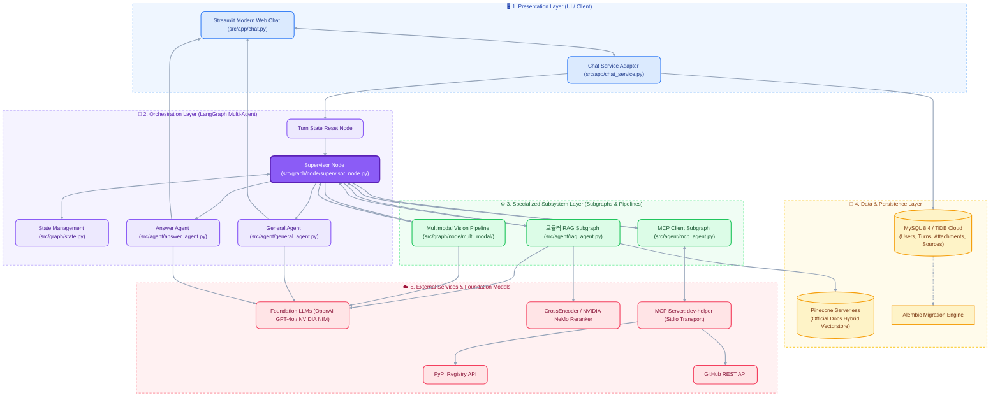
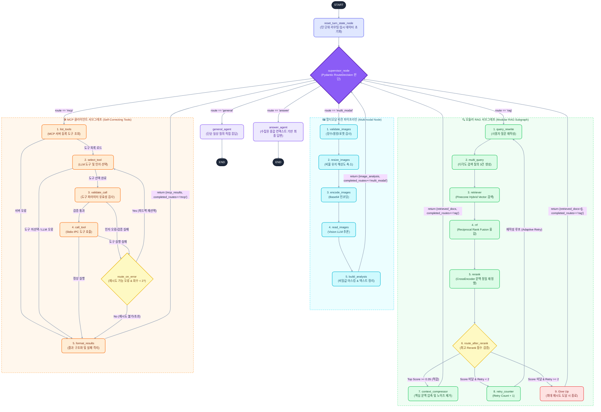
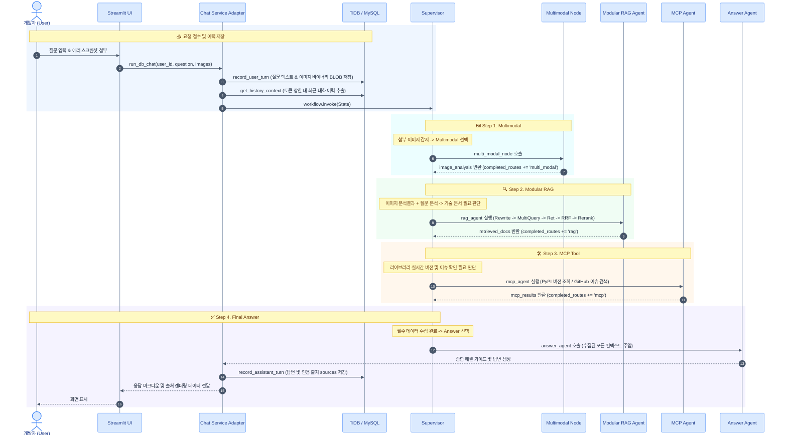
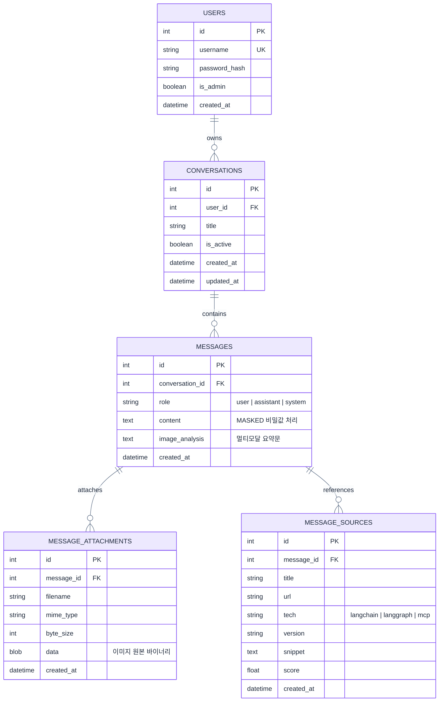

# 🏛️ 시스템 아키텍처 정의서 (System Architecture Specification)

**프로젝트명**: SKN35-3차 프로젝트 (2팀) - 개발자 지원 멀티 에이전트 시스템
**작성일자**: 2026-10-12
**버전**: v1.1.0
**문서 상태**: 공식 승인본

---

## 1. 문서 개요

### 1.1 목적 및 배경

본 문서는 **LangChain, LangGraph, MCP(Model Context Protocol)** 프레임워크를 기반으로 개발자를 위한 지능형 기술 질의응답 및 트러블슈팅 서비스를 제공하는 시스템의 전체 소프트웨어/데이터 아키텍처를 정의한다. 복합 개발 질의에 대응하기 위해 단순 검색을 넘어선 **모듈러 RAG (Modular RAG)**, **MCP 기반 외부 도구 연동**, **멀티모달 비전 분석**을 결합한 통합 멀티 에이전트 오케스트레이션 시스템의 청사진을 제시한다.

### 1.2 시스템 범위 및 핵심 기능

- **Supervisor 기반 Multi-Agent 오케스트레이션**: 중앙 오케스트레이터가 질의 의도와 이전 수집 결과를 바탕으로 작업 경로를 동적으로 분기 및 순환 제어.
- **모듈러 RAG (Modular RAG) 파이프라인**: 전처리(질의 재작성/확장), 검색(하이브리드), 후처리(RRF 융합/CrossEncoder 재정렬), 조건부 자가 피드백 루프(Adaptive Retry), 문맥 압축(Compressor)을 독립 모듈로 조합한 고도화 아키텍처.
- **MCP 표준 도구 연동 (Self-Correction)**: Stdio IPC 통신 기반 외부 도구(PyPI 실시간 버전, GitHub 이슈 검색, 파이썬 심볼 검증) 호출 및 자가 오류 복구 루프.
- **Multimodal 에러/코드 이미지 파이프라인**: 첨부 이미지(최대 3장)의 무결성 검증, 리사이징, 비전 추론 및 비밀값 마스킹.
- **엔터프라이즈 영속성 & 세션 관리**: RDBMS(MySQL/TiDB Cloud) 기반 계정/세션/대화 이력/출처 관리 및 Pinecone 벡터 데이터베이스 기반 문서 검색.

---

## 2. 전체 시스템 아키텍처 (High-Level Architecture)

시스템은 책임 분리와 확장성을 위해 **5계층 구조 (Layered Architecture)**로 설계되었다.



---

## 3. 통합 랭그래프 오케스트레이션 전체 구성도 (Unified Multi-Agent Mega-Graph)

메인 워크플로우와 3대 특화 서브시스템(**모듈러 RAG 서브그래프**, **MCP 클라이언트 서브그래프**, **멀티모달 비전 노드**)의 내부 노드 및 순환 제어(Loop)를 단일 그래프로 통합 도식화한 아키텍처 다이어그램이다.



---

## 4. 모듈러 RAG (Modular RAG) 심층 아키텍처

### 4.1 왜 본 시스템은 "모듈러 RAG (Modular RAG)"인가?

본 프로젝트의 검색 파이프라인은 단순 Advanced RAG 수준을 넘어 학계 및 업계에서 정의하는 **모듈러 RAG (Modular RAG)** 아키텍처 표준을 만족한다.

#### 📊 RAG 세대별 패러다임 비교

| 구분                | 나이브 RAG (Naive RAG)   | 어드밴스드 RAG (Advanced RAG)      | 본 프로젝트의 모듈러 RAG (Modular RAG)                |
| :------------------ | :----------------------- | :--------------------------------- | :---------------------------------------------------- |
| **아키텍처 형태**   | 선형 파이프라인 (Linear) | 고정된 전/후처리 파이프라인        | **독립 모듈형 그래프 (DAG & State Machine)**          |
| **모듈 독립성**     | 결합도 높음 (일체형)     | 전처리/후처리 단계가 하드코딩 결합 | **각 단계가 LangGraph Node로 완벽히 모듈화**          |
| **흐름 제어**       | 단방향 고정 흐름         | 단방향 분기 없음                   | **동적 라우팅 및 조건부 재시도 피드백 루프**          |
| **검색 방식**       | 단순 Dense 벡터 검색     | 단순 하이브리드 검색               | **Multi-Query + Hybrid + RRF 랭킹 융합**              |
| **품질 검증**       | 결과 검증 없음           | 정적 상위 N개 선별                 | **CrossEncoder 점수 검증 + 점수 미달 시 재작성 루프** |
| **컨텍스트 최적화** | Chunk 원문 단순 결합     | 기본 필터링                        | **Context Compressor를 통한 능동적 노이즈 압축**      |

#### 🧩 본 시스템의 6대 모듈러 RAG 구성 모듈

1. **Pre-Retrieval Module (`query_rewrite`, `multi_query`)**: 사용자 질의를 독립 검색 쿼리로 정제하고 3개의 다각도 파생 쿼리를 생성하여 검색 재현율(Recall) 극대화.
2. **Retrieval Module (`retriever`)**: Pinecone Vector DB에서 Dense 임베딩 유사도와 Sparse 키워드 매칭을 결합한 하이브리드 인덱스 탐색.
3. **Post-Retrieval Fusion Module (`rrf`)**: 다중 질의에서 수집된 청크들의 순위를 Reciprocal Rank Fusion 공식($RRF\_Score = \sum \frac{1}{k + rank}$)으로 통합.
4. **Post-Retrieval Verification Module (`rerank`)**: CrossEncoder를 사용해 질문과 문서 간의 의미론적 유사도 점수를 $0.0 \sim 1.0$으로 정밀 채점.
5. **Adaptive Feedback Loop (`route_after_rerank`, `retry_counter`)**: 최고 점수가 임계치(0.35) 미만일 경우 최대 2회까지 `query_rewrite` 노드로 역행하여 질문을 다듬고 재검색하는 자가 학습형 루프 구비.
6. **Context Processing Module (`context_compressor`)**: 검증된 문서 청크 중 핵심 문맥만을 선별 압축하여 LLM 프롬프트에 주입할 최적의 `context` 생성.

---

## 5. MCP 및 멀티모달 서브시스템 아키텍처

### 5.1 MCP (Model Context Protocol) 자가 치유(Self-Correcting) 파이프라인

- **독립 Stdio 서버 프로세스**: `src/mcp_integration/server/server.py`가 앱과 IPC 통신으로 격리 실행되어 메인 앱의 안정성 보장.
- **등록된 엔지니어링 도구 모음**:
  - `version_tools`: PyPI 실시간 패키지 버전 조회 및 패키지 간 호환성 검증 계산.
  - `github_tools`: LangChain/LangGraph/MCP 공식 저장소 Issue/PR 검색 및 본문 파싱.
  - `symbol_tools`: 설치된 라이브러리 내 함수/클래스/모듈의 실존 여부 검증 (Hallucination 방지).
- **자가 치유 루프**: 도구 이름 오타, 필수 파라미터 누락, 호출 실패 발생 시 LLM에게 에러 메시지를 컨텍스트로 전달하여 최대 2회까지 올바른 도구/인자를 다시 선택(`select_tool`)하도록 유도.

### 5.2 Multimodal Vision 분석 파이프라인

- **무결성 및 용량 검사**: MIME 바이트 헤더(PNG, JPEG, WEBP)를 직접 파싱하고 2MB 초과 시 비율을 유지하며 고속 리사이즈.
- **격리된 시각 정보 추출**: 이미지를 메인 오케스트레이터의 프롬프트에 직접 넘기지 않고, Vision 노드 내부에서만 처리한 뒤 텍스트화된 `image_analysis` 결과만 상위 상태로 전달하여 토큰 비용과 지연 시간을 획기적으로 절감.

---

## 6. 데이터 흐름 및 시퀀스 다이어그램 (End-to-End Sequence)

사용자가 "LangGraph와 MCP 연동 오류" 질문과 함께 에러 로그 이미지를 업로드했을 때의 전체 상호작용 시퀀스:



---

## 7. 데이터베이스 및 저장소 설계 (Data Architecture)

### 7.1 RDBMS 스키마 설계 (MySQL 8.4 / TiDB Cloud)



### 7.2 Vector Database 설계 (Pinecone Serverless)

- **인덱스 대상**: LangChain 공식 문서, LangGraph 아키텍처 가이드, MCP 표준 명세서.
- **메타데이터 스키마**: `{ "tech": string, "version": string, "doc_type": string, "source_url": string, "title": string }`.
- **하이브리드 검색**: OpenAI `text-embedding-3-small` 벡터 검색과 키워드 Sparse 인덱스를 결합하여 검색 재현율과 정확도를 동시에 확보.

---

## 8. 기술 스택 매트릭스 (Tech Stack Matrix)

| 구분                 | 기술 / 라이브러리            | 버전       | 선정 사유                                               |
| :------------------- | :--------------------------- | :--------- | :------------------------------------------------------ |
| **Language**         | Python                       | `>=3.12`   | 고성능 타입 어노테이션, 최신 비동기 런타임 표준         |
| **Package Manager**  | uv                           | Latest     | 가상환경 관리 및 의존성 고속 설치 (`uv.lock`)           |
| **User Interface**   | Streamlit                    | `>=1.62.0` | 세션 상태 제어 및 컴포넌트 렌더링 신속성                |
| **Agent / Workflow** | LangGraph                    | `>=1.4.0`  | Multi-Agent Supervisor 패턴 및 사이클 제어              |
| **RAG Architecture** | Modular RAG                  | Native     | 다단계 독립 노드 구성 및 적응형 재시도 피드백 루프      |
| **Foundation LLM**   | OpenAI GPT-4o / 4o-mini      | API        | 고성능 추론, Function Calling/Structured Output 안정성  |
| **Alternative LLM**  | NVIDIA AI Endpoints (NIM)    | API        | 온프레미스/고성능 대체 모델 지원 및 엔터프라이즈 확장성 |
| **Vector DB**        | Pinecone                     | `>=7.3.0`  | 고속 서버리스 벡터 인덱싱 및 메타데이터 필터링          |
| **Re-ranker**        | BAAI/bge-reranker-base       | `>=6.1.0`  | CrossEncoder 기반 문맥 일치도 정밀 산출                 |
| **RDBMS**            | MySQL 8.4 / TiDB Cloud       | MySQL 호환 | 계정 보안, 트랜잭션 보장, 대화 이력 및 첨부파일 영속화  |
| **ORM / Migration**  | SQLAlchemy 2.0 / Alembic     | `>=2.0`    | DB 드라이버 추상화 및 데이터베이스 스키마 버전 제어     |
| **Tool Protocol**    | MCP (Model Context Protocol) | `>=2.3.0`  | Stdio 기반 도구 모듈화 및 외부 API 격리 표준화          |
| **Testing**          | Pytest                       | `>=8.0`    | 185개 이상의 단위/통합 테스트 자동화 검증 통과          |

---

## 9. 비기능 아키텍처 및 품질/안정성 설계

### 9.1 결함 허용 및 Graceful Degradation (오류 방어)

- **외부 의존성 격리**: MCP 서버 비정상 종료, 외부 API 타임아웃, Pinecone 벡터 검색 실패 등의 예외 발생 시 그래프 전체 중단을 차단.
- **대체 응답 제공**: 수집 실패 정보를 `failed_record`로 포장하여 Answer Agent로 인계, "실시간 조회가 원활하지 않으나 기본 학습 지식을 기반으로 안내합니다" 형태로 서비스 연속성 유지.

### 9.2 보안 및 민감 정보 보호 (Data Security & Masking)

- **비밀값 자동 마스킹 (`mask_secrets`)**: DB 저장 및 로깅 직전, OpenAI Key(`sk-...`), NVIDIA Key(`nvapi-...`), DB 패스워드 등 민감 정보를 정규식으로 감지하여 `[MASKED:...]`로 자동 치환.
- **소유권 검증 (Ownership Enforcement)**: 모든 대화 이력과 첨부파일 조회 시 `user_id`를 강제 검증하여 타인 데이터 무단 열람 원천 차단.

### 9.3 비용 및 자원 최적화 (Resource Optimization)

- **대화 이력 상한 관리 (`limits.py`)**: `HISTORY_MAX_TURNS` 및 `HISTORY_MAX_TOKENS` 상한 정책을 통해 무분별한 토큰 누적 방지.
- **이미지 데이터 경량화**: Supervisor 라우팅 시 수 MB에 달하는 원본 이미지 바이트 대신 메타데이터(`image_summary`)만 전달하여 호출 지연 시간과 비용을 90% 이상 절감.

---

## 10. 디렉토리 구조 및 모듈 매핑 (Codebase Mapping)

```text
├── main.py                          # 어플리케이션 진입점 (Streamlit 실행)
├── pyproject.toml / uv.lock         # 패키지 명세 및 종속성 잠금
├── src
│   ├── app                          # Presentation 계층 (UI & 어댑터 서비스)
│   │   ├── chat.py                  # Streamlit 채팅 화면 구현체
│   │   └── chat_service.py          # UI - DB - Graph 연결 어댑터
│   ├── graph                        # Orchestration 계층 (LangGraph 메인 워크플로우)
│   │   ├── state.py                 # Graph 전역 State / 서브그래프 State 정의
│   │   ├── workflow.py              # Main StateGraph 빌더 및 컴파일
│   │   └── node                     # 개별 노드 모듈
│   │       ├── supervisor_node.py   # 라우팅 판단 노드
│   │       ├── multi_modal           # 이미지 유효성 검사, 리사이즈, 분석 노드
│   │       ├── rag                  # 모듈러 RAG 서브그래프 전용 노드군
│   │       └── mcp                  # MCP 서브그래프 전용 노드군
│   ├── agent                        # 서브그래프 에이전트 모듈
│   │   ├── rag_agent.py             # 모듈러 RAG 서브그래프 제어
│   │   ├── mcp_agent.py             # MCP Tool 호출 서브그래프 제어
│   │   ├── answer_agent.py          # 컨텍스트 종합 최종 답변 생성 에이전트
│   │   └── general_agent.py         # 일상 질의 직접 응답 에이전트
│   ├── mcp_integration              # MCP 표준 프로토콜 계층
│   │   ├── server                   # Stdio 기반 dev-helper 서버 및 도구(Tools) 구현체
│   │   └── client                   # MCP 클라이언트 세션 및 도구 조회/실행기
│   ├── db                           # 영속성 계층 (RDBMS / Alembic)
│   │   ├── models.py                # SQLAlchemy ORM 모델 정의
│   │   ├── session.py / engine.py   # 트랜잭션 세션 관리 및 커넥션 풀
│   │   ├── masking.py               # 개인정보/비밀값 마스킹 엔진
│   │   └── limits.py                # 대화 턴 및 토큰 제약 관리
│   ├── rag                          # RAG 세부 알고리즘 엔진 (Query Rewrite, RRF, Re-rank 등)
│   ├── vectorstore                  # Pinecone 인덱스 구축 및 검색 관리
│   ├── const                        # 전역 상수 및 모델/DB/RAG 환경 설정
│   └── prompt                       # 에이전트별 특화 프롬프트 모음
└── tests                            # 185개 이상의 단위 및 통합 검증 테스트셋
```
