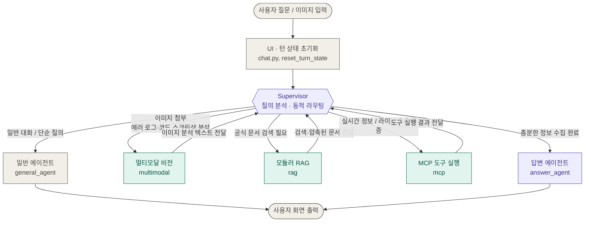

# Supervisor 허브 앤 스포크 프로세스 흐름도

사용자의 질문이 입력되면 중앙 제어 타워인 Supervisor가 질의를 분석하여 필요한 특화 에이전트를 순차적으로 호출하고, 최종 답변을 취합해 사용자에게 전달하는 허브 앤 스포크(Hub-and-Spoke) 구조입니다.

## 1. 전체 프로세스 흐름도

- 보라: 제어 · 최종 응답 (Supervisor, answer_agent)
- 청록: 정보 수집 도구 (Vision, RAG, MCP) — 결과가 Supervisor로 돌아오며 필요 시 순환 호출
- 회색: 입출력 · 일반 경로

---

## 2. 프로세스 흐름 (3단계)

### 1단계: 사용자 입력 및 턴 초기화

1. 사용자가 `chat.py`에서 질문(텍스트 또는 이미지)을 입력합니다.
2. 새 턴이 시작되면 `reset_turn_state`에서 이전 임시 검색 결과와 라우팅 상태를 초기화합니다.

### 2단계: Supervisor의 상황 판단 및 정보 수집

`supervisor_node`가 질문 유형과 현재까지 모인 정보를 분석해 다음 작업을 결정합니다.

- **단순 인사 / 일반 질의**: `general_agent`로 즉시 답변 후 종료
- **이미지가 첨부된 경우**: `multimodal_node`에서 이미지 해상도 조정 후 Vision LLM을 통해 에러 메시지/코드를 텍스트로 추출
- **기술 질문 (LangChain, LangGraph, MCP 등)**: `rag_node`를 통해 Pinecone 벡터 DB에서 공식 문서를 검색 (질문 재작성 → 3개 파생 질의 생성 → 하이브리드 검색 → Reranker 검증 → 컨텍스트 압축)
- **실시간 외부 검증 (버전 확인, 이슈 검색 등)**: `mcp_node`를 통해 MCP 서버 도구(PyPI 실시간 버전, GitHub Issue 검색, 파이썬 심볼 검증) 호출

> 정보가 부족하거나 추가 검증이 필요한 경우 Supervisor가 여러 도구(Vision → RAG → MCP)를 차례로 순환하며 수집합니다.

### 3단계: 최종 답변 생성 및 영속 저장

1. 필요한 정보가 모두 갖춰지면 Supervisor가 `answer_agent`로 분기합니다.
2. 수집된 문서, 도구 실행 결과, 이미지 분석 내용을 종합하여 개발자 친화적인 최종 기술 답변을 생성합니다.
3. 생성된 답변과 출처는 사용자 화면에 표시되고, 관계형 DB(MySQL/TiDB)에 대화 이력으로 저장됩니다.

---

## 3. 계층별 아키텍처 구성

| 계층                          | 주요 파일 및 모듈                                       | 역할                                                                                                    |
| ----------------------------- | ------------------------------------------------------- | ------------------------------------------------------------------------------------------------------- |
| 1. UI / Presentation          | `chat.py`, `chat_service.py`                            | Streamlit 웹 채팅 UI, 사용자 세션 관리 및 워크플로우 호출                                               |
| 2. 오케스트레이션 (LangGraph) | `workflow.py`, `state.py`, `supervisor_node.py`         | 상태(State) 기반 전체 워크플로우 제어, 의도에 따른 에이전트 동적 라우팅                                 |
| 3. 도구 & 서브 에이전트       | `rag_agent.py`, `mcp_agent.py`, `answer_agent.py`       | RAG: 문서 검색/재정렬/압축, MCP: PyPI / GitHub / Symbol 검증 도구, Vision: 스크린샷 및 로그 이미지 판독 |
| 4. 데이터 & 영속성            | `src/db/` (TiDB / MySQL), `src/vectorstore/` (Pinecone) | 사용자 계정, 대화 턴, 출처 데이터 영속화, 공식 문서 하이브리드 벡터 검색 인덱스                         |

---

## 4. 이 아키텍처의 3가지 핵심 강점

1. **중앙 집중식 유연한 제어 (Supervisor)**: 고정된 순서로 실행되지 않고 질문에 따라 필요한 도구만 골라 실행하므로 토큰 비용과 응답 지연을 최소화합니다.
2. **모듈러 RAG (Modular RAG)**: 단순 검색이 아닌 질문 재작성 → 3개 다각도 검색 → Rerank 점수 검증(부족 시 재검색) → 문맥 압축 단계를 거쳐 환각(Hallucination)을 대폭 줄였습니다.
3. **MCP 표준 도구 연동**: 공식 문서 검색뿐 아니라 PyPI 최신 패키지 버전이나 실제 존재하는 함수/클래스인지 실시간으로 교차 검증합니다.
